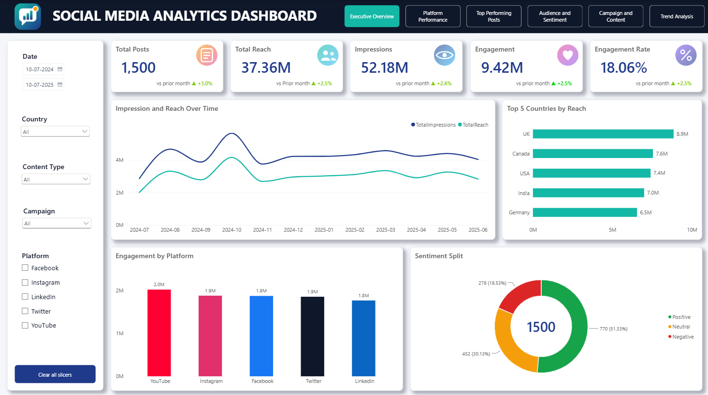
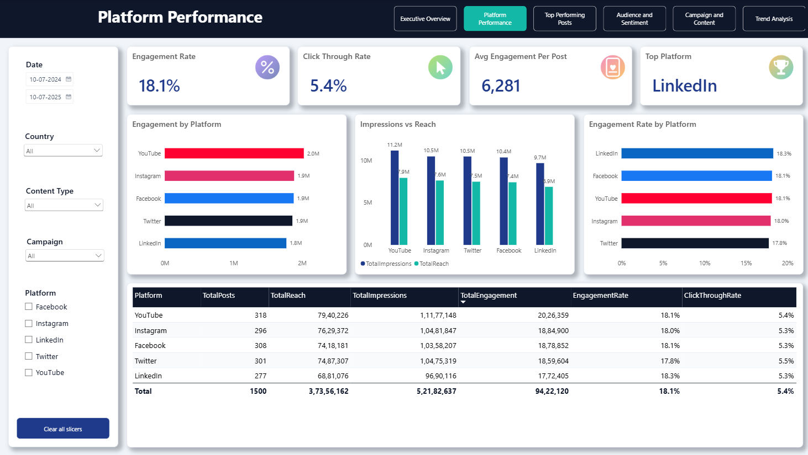
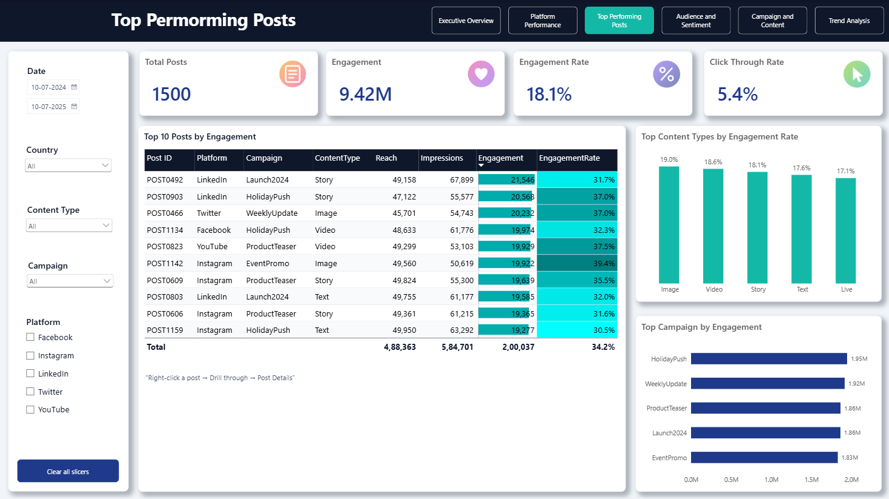
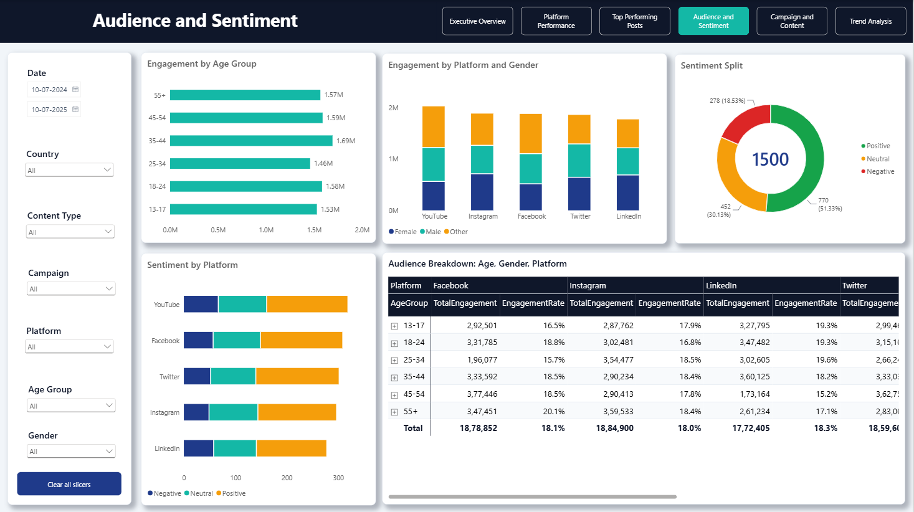
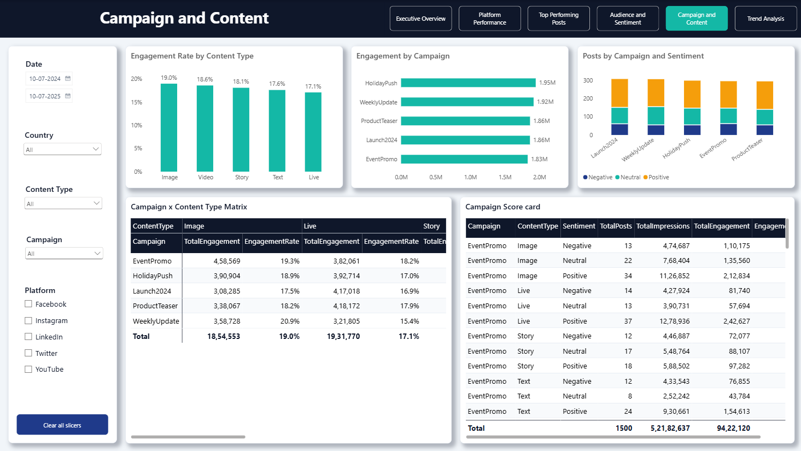
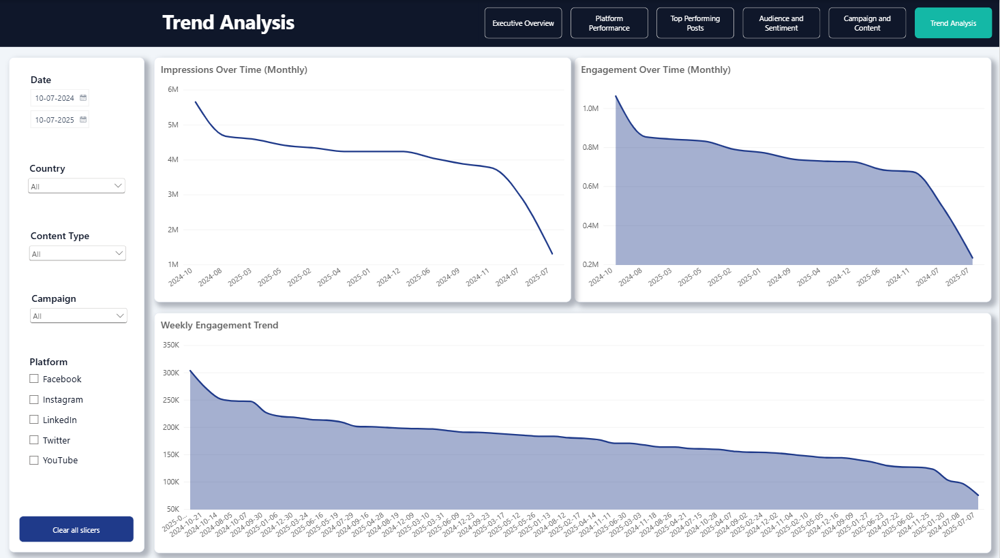
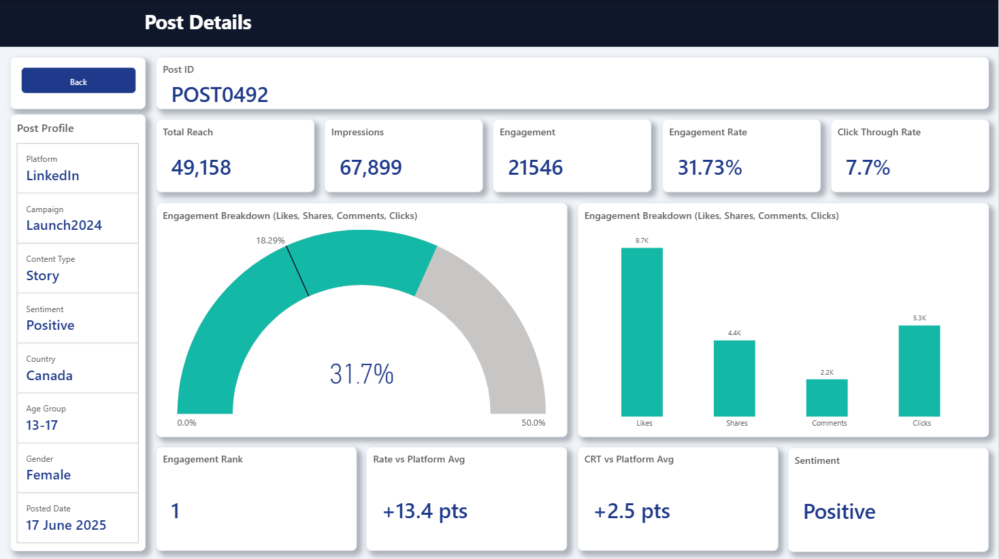

<div align="center">

# Social Media Analytics Dashboard

**An interactive 7-page Power BI report that turns 1,500 social media posts into clear answers on reach, engagement, audience and campaign performance.**




</div>

---

## Table of Contents

1. [Project Overview](#project-overview)
2. [Business Questions](#business-questions)
3. [Dashboard Preview](#dashboard-preview)
   - [Page 1: Executive Overview](#page-1-executive-overview)
   - [Page 2: Platform Performance](#page-2-platform-performance)
   - [Page 3: Top Performing Posts](#page-3-top-performing-posts)
   - [Page 4: Audience and Sentiment](#page-4-audience-and-sentiment)
   - [Page 5: Campaign and Content](#page-5-campaign-and-content)
   - [Page 6: Trend Analysis](#page-6-trend-analysis)
   - [Page 7: Post Details (Drill-through)](#page-7-post-details-drill-through)
4. [Key Insights](#key-insights)
5. [Features](#features)
6. [Data Model and Measures](#data-model-and-measures)
7. [Design Decisions](#design-decisions)
8. [Tools and Skills](#tools-and-skills)
9. [Project Structure](#project-structure)
10. [How to Open the Report](#how-to-open-the-report)
11. [Future Improvements](#future-improvements)
12. [Author](#author)

---

## Project Overview

This project analyses social media performance across **five platforms** (Facebook, Instagram, LinkedIn, Twitter and YouTube) over a 12-month period. It covers **1,500 posts** and is built as a guided report: an executive summary first, then platform, post, audience, campaign and trend views, and finally a drill-through page for any single post.

[Back to top](#social-media-analytics-dashboard)

## Business Questions

- Which platforms, campaigns and content types drive the most engagement?
- How are reach, impressions and engagement trending month over month?
- Which countries and audience segments (age group, gender) respond best, and what is their sentiment?
- Which individual posts perform best, and how does each compare with its platform average?

[Back to top](#social-media-analytics-dashboard)

## Dashboard Preview

### Page 1: Executive Overview


A one-screen summary for decision makers.
- Five KPI cards (Total Posts, Reach, Impressions, Engagement, Engagement Rate) with month-over-month change
- Impressions and reach trend line
- Top 5 countries by reach
- Engagement by platform and sentiment split

### Page 2: Platform Performance


Compares the five platforms side by side.
- KPI cards for Engagement Rate, Click-Through Rate, Average Engagement per Post and Top Platform
- Engagement, Impressions vs Reach, and Engagement Rate by platform
- Detail table with data bars and a color scale

### Page 3: Top Performing Posts


Ranks the 10 best posts by total engagement.
- Top 10 table at post level, ready for drill-through
- Engagement Rate by content type
- Top campaigns by engagement

### Page 4: Audience and Sentiment


Shows who the audience is and how they feel.
- Engagement by age group and gender
- Sentiment split and sentiment by platform
- Country and platform breakdown matrix

### Page 5: Campaign and Content


Evaluates campaign and content-type performance.
- Campaign ranking by engagement
- Content type comparison
- Campaign by content type matrix (heatmap)

### Page 6: Trend Analysis


Tracks performance over time.
- Monthly impressions and reach
- Engagement area chart and weekly stacked view

### Page 7: Post Details (Drill-through)


Right-click any post on Page 3 and choose **Drill through > Post Details**.
- Post ID, profile (platform, campaign, content type, sentiment, country, age group, gender, date)
- Reach, impressions, engagement, engagement rate and CTR
- Engagement breakdown: likes, shares, comments, clicks
- Gauge comparing the post's engagement rate with its platform average
- Rank and "points above platform average" cards

[Back to top](#social-media-analytics-dashboard)

## Key Insights

> Verify each figure against the final report before publishing.

| # | Insight |
|---|---|
| 1 | The dataset holds **1,500 posts**, **37.36M reach**, **52.18M impressions** and **9.42M engagements**, an overall engagement rate of **18.06%**. |
| 2 | **YouTube** leads on total engagement (about 2.0M), but all five platforms land within a narrow 1.8M to 2.0M range. |
| 3 | The **UK** has the highest reach (8.9M), followed by Canada (7.6M) and the USA (7.4M). |
| 4 | About **51%** of posts have positive sentiment, **30%** neutral and **19%** negative. |
| 5 | **Image** and **Video** content have the highest engagement rates (about 19.0% and 18.6%). |
| 6 | The top post, **POST0492** (LinkedIn, Launch2024, Story), reaches a **31.7%** engagement rate, about 13 points above its platform average. |

[Back to top](#social-media-analytics-dashboard)

## Features

- **Custom navigation:** a page navigator in every header, with the active page highlighted
- **Synced slicers:** Date, Platform, Country, Content Type and Campaign stay in sync across pages
- **Drill-through:** post-level detail page opened from the Top Performing Posts table
- **Conditional formatting:** data bars and color scales in tables and matrices
- **Month-over-month deltas:** reference labels on KPI cards
- **Custom theme and icons:** navy and teal palette, consistent sentiment colors (green, amber, red) and brand colors for platforms

[Back to top](#social-media-analytics-dashboard)

## Data Model and Measures

**Tables**

| Table | Purpose |
|---|---|
| `SocialMediaInsights` | One row per post: PostID, Platform, Campaign, ContentType, Sentiment, Country, AgeGroup, Gender, PostedDate, Reach, Impressions, Likes, Shares, Comments, Clicks |
| `DateTable` | Calendar table for time intelligence (Year, Quarter, Month, Week, Year-Month) |

**Key DAX measures**

```DAX
EngagementRate = DIVIDE([TotalEngagement], [TotalImpressions], 0)

Prev Month Engagement =
CALCULATE([TotalEngagement], DATEADD(DateTable[Date], -1, MONTH))

Engagement MoM % =
DIVIDE([TotalEngagement] - [Prev Month Engagement], [Prev Month Engagement])

Platform Avg Engagement Rate =
VAR p = SELECTEDVALUE(SocialMediaInsights[Platform])
RETURN
CALCULATE(
    [EngagementRate],
    REMOVEFILTERS(SocialMediaInsights[PostID]),
    SocialMediaInsights[Platform] = p
)

Rate vs Platform Avg =
VAR d = [EngagementRate] - [Platform Avg Engagement Rate]
RETURN FORMAT(d * 100, "+0.0;-0.0") & " pts"
```

[Back to top](#social-media-analytics-dashboard)

## Design Decisions

- **Layout:** 1920 x 1080 canvas on a 20 px grid, with a fixed header and a left slicer panel on every page
- **Color:** navy `#1F3A8A` and teal `#14B8A6` as primary colors, with `#16A34A`, `#F59E0B` and `#DC2626` reserved for sentiment
- **Typography:** Segoe UI, with large KPI values (40 pt) and clear 16 pt visual titles
- **Storytelling:** summary first, then comparison, then ranking, then detail
- **Accuracy:** value axes start at zero, partial months are excluded, and rates are shown as percentages

[Back to top](#social-media-analytics-dashboard)

## Tools and Skills

| Area | Details |
|---|---|
| Tool | Power BI Desktop |
| Language | DAX, Power Query (M) |
| Skills shown | Data modeling, KPI design, time intelligence, drill-through, slicer syncing, conditional formatting, dashboard UX and storytelling |

[Back to top](#social-media-analytics-dashboard)

## Project Structure

```
social-media-analytics-dashboard/
├── assets/
│   └── logo_icon.png     (KPI icons)
├── data/
│   └── SocialMediaInsights.csv
├── screenshots/
│   ├── 01-executive-overview.png
│   ├── 02-platform-performance.png
│   ├── 03-top-performing-posts.png
│   ├── 04-audience-sentiment.png
│   ├── 05-campaign-content.png
│   ├── 06-trend-analysis.png
│   └── 07-post-details.png
├── theme/
│   └── SocialMedia_Theme.json
├── README.md
└── Social_Media_Dashboard.pbix

```

[Back to top](#social-media-analytics-dashboard)

## How to Open the Report

1. Install [Power BI Desktop](https://powerbi.microsoft.com/desktop/) (free, Windows).
2. Download or clone this repository.
3. Open `Social_Media_Dashboard.pbix`.
4. If Power BI asks for the data source, go to **Home > Transform data > Data source settings > Change Source** and select `data/SocialMediaInsights.csv`.
5. Optional: apply the theme with **View > Themes > Browse for themes** and choose `theme/SocialMedia_Theme.json`.

To test the drill-through, open **Top Performing Posts**, right-click a row and choose **Drill through > Post Details**.

[Back to top](#social-media-analytics-dashboard)

## Future Improvements

- Connect to a live source (API or SQL) with scheduled refresh
- Add forecasting for engagement
- Add a mobile layout
- Add row-level security by region

[Back to top](#social-media-analytics-dashboard)

## Author

**Mohammed Sameer**
Data Analyst | Power BI | DAX
[LinkedIn](https://www.linkedin.com/in/mohammed-sameer-136227300/) | [GitHub](https://github.com/sameer0819) | md8630214@gmail.com

*Dataset: practice data for learning purposes. No personal information is included.*
